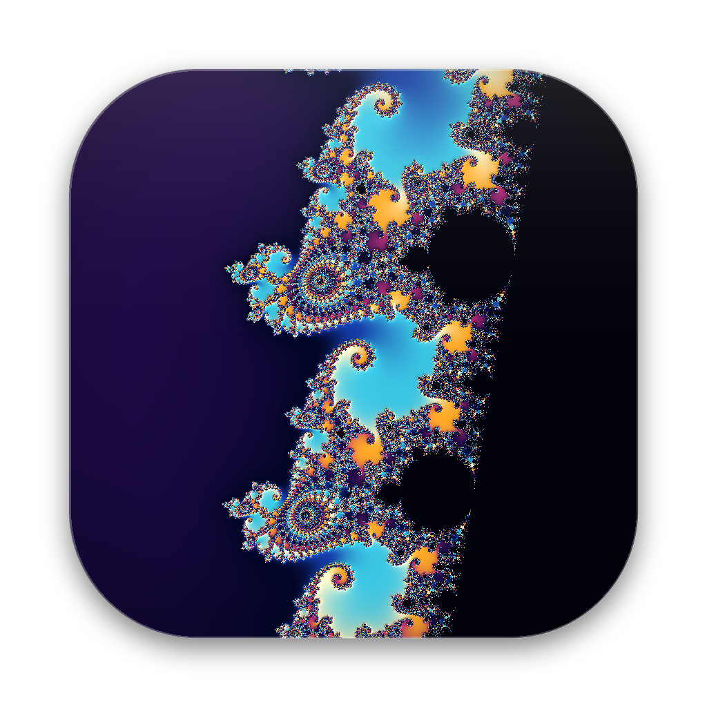
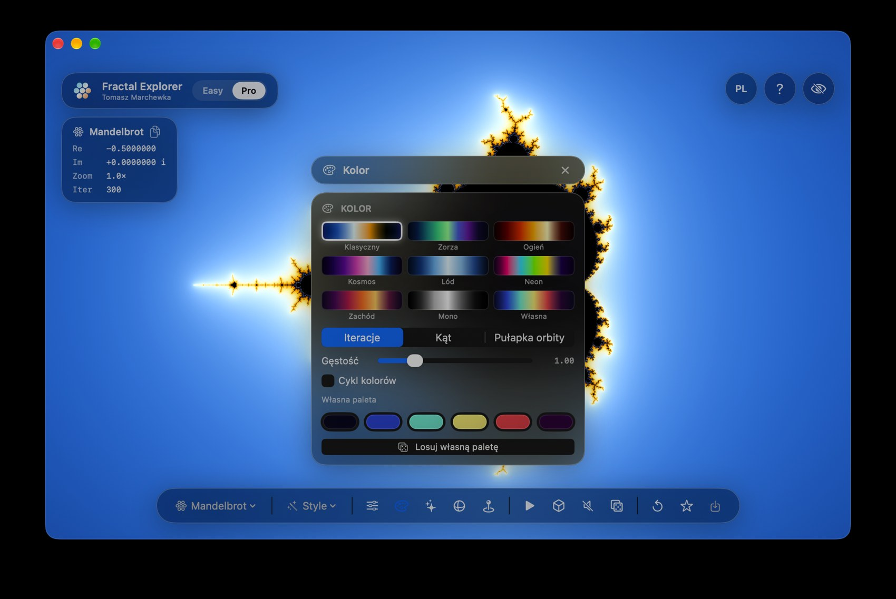
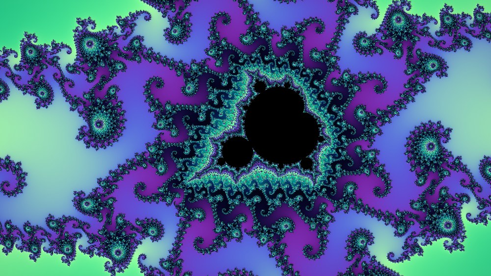
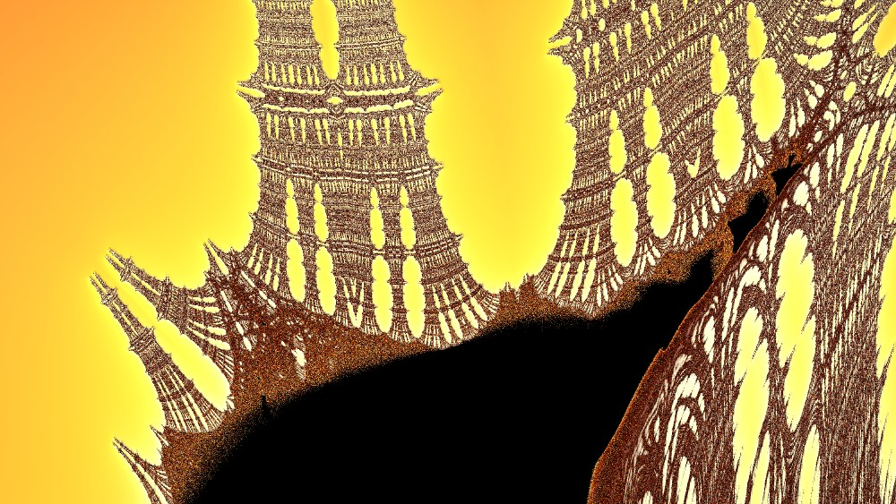
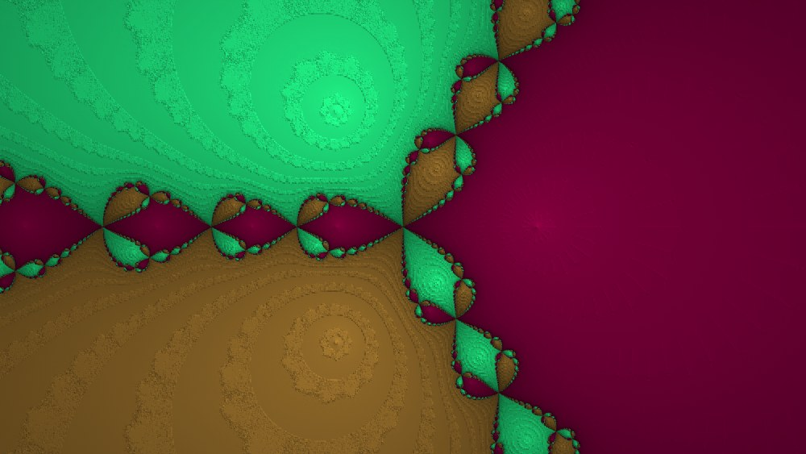

> ⬇️ **[Pobierz / Download Fractal Explorer (DMG)](https://github.com/Carrot79PL/fractal-explorer/releases/latest)** · macOS 14+, Apple Silicon · darmowa / free · pierwsze uruchomienie: prawy przycisk → Otwórz

<p align="center"></p>

# Fractal Explorer

🇵🇱 [Polski](#polski) · 🇬🇧 [English](#english)





---

## Polski

Natywna aplikacja na macOS do eksploracji fraktali w czasie rzeczywistym, napisana w **Swift + SwiftUI + Metal**. Cała matematyka fraktali liczy się w shaderze Metal na GPU. Interfejs w stylu „Liquid Glass” (szklane kapsuły `ultraThinMaterial`).

**Autor:** Tomasz Marchewka

### Możliwości

- **Tryby Easy / Pro:** Easy to czysty, prosty interfejs; Pro odsłania w dolnym menu wszystkie opcje (model, kolor, efekty, obrót/3D/muzyka, miejsca), współrzędne i iteracje.
- **Ekran startowy** w stylu Photoshopa z fraktalem, nazwą i autorem.
- **Style** (gotowe zestawy palety i efektów), **niespodzianka** (losowe miejsce + styl), **losowa paleta**, **wycieczka** po miejscach, kopiowanie współrzędnych i obrazu do schowka.
- **6 modeli:** Mandelbrot, Płonący statek, Tricorn, Multibrot (potęga 2–8), zbiory Julii (z wyborem punktu pod kursorem), Newton z³−1.
- **Głęboki zoom Mandelbrota (do ok. 10²⁵×)** dzięki teorii perturbacji: orbita referencyjna liczona na CPU w double-double, różnice liczone na GPU z rebasingiem.
- **Płynne kolory bez pasm** (gładka liczba iteracji, dithering), 9 palet (w tym własna), 3 tryby koloru (iteracje / kąt / pułapka orbity), płynne przejścia między paletami, cykl kolorów.
- **Efekty:** relief 3D, poświata, antyaliasing 2×2 w spoczynku, winieta.
- **Sterowanie:** zoom w punkt pod kursorem (kółko / gest pinch), przesuwanie przeciągnięciem z tłumieniem, podwójne kliknięcie = zoom ×2, film z automatycznym zoomem.
- **Adaptacyjna rozdzielczość** w ruchu, by utrzymać płynność; pełna jakość po zatrzymaniu.
- **Miejsca:** 8 gotowych widoków + własne ulubione z nazwami (zapamiętują pozycję i WSZYSTKIE ustawienia wyglądu).
- **Eksport PNG** w 4K i 8K.
- **Obrót widoku:** skręć dwa palce na gładziku (wokół kursora, z martwą strefą, tłumieniem i „magnesem” na 45°), `⌥` + przeciąganie, klawisze `Q`/`E`, suwak, automatyczny obrót.
- **Krajobraz 3D:** fraktal jako oświetlony teren sięgający horyzontu (lustrzane kafelki, mgła, niebo), regulowane nachylenie i wysokość; działa z obrotem i zoomem.
- **Muzyka ambient:** generowana na żywo (akordy, dzwonki, pogłos); im głębszy zoom, tym jaśniejsze brzmienie.
- **Więcej efektów:** kalejdoskop, kolorowe wnętrze zbioru, nasycenie, kontrast, odwrócenie kolorów.
- **Dwujęzyczny interfejs PL/EN** (przycisk w prawym górnym rogu; domyślnie język systemu).

### Skróty klawiszowe

| Klawisz | Akcja |
|---|---|
| `1`–`6` | wybór modelu |
| `Spacja` | film: automatyczne powiększanie |
| `R` | reset widoku |
| `I` | zamknij kartę opcji |
| `H` | ukryj / pokaż interfejs |
| `Q` / `E` | obrót widoku |
| `D` | krajobraz 3D |
| `S` | niespodzianka (losowy styl) |
| `T` | wycieczka po miejscach |
| `?` | pomoc ze skrótami |
| `M` | muzyka |
| `J` | zbiór Julii z punktu pod kursorem |

### Budowanie

Wymagania: macOS 14+, Xcode Command Line Tools oraz komponent Metal Toolchain (`xcodebuild -downloadComponent MetalToolchain`). Pełny Xcode nie jest potrzebny.

```bash
git clone https://github.com/Carrot79PL/fractal-explorer.git
cd fractal-explorer
./build.sh
open "Fractal Explorer.app"
```

Ikonę można wygenerować ponownie skryptem `make_icon.py` (wymaga Pythona z `numpy` i `Pillow`).

### Ograniczenia

Poza Mandelbrotem modele liczą w `float32`, więc zoom jest w nich ograniczony do ok. 4·10⁴×. Mandelbrot ma limit ok. 10²⁵×, więc zoom nie jest nieskończony.

### Licencja

MIT — zobacz [LICENSE](LICENSE).

---

## English

A native macOS app for real-time fractal exploration, written in **Swift + SwiftUI + Metal**. All fractal math runs in a Metal shader on the GPU. The UI follows a “Liquid Glass” look (`ultraThinMaterial` capsules).

**Author:** Tomasz Marchewka

### Features

- **Easy / Pro modes:** Easy is a clean, simple interface; Pro reveals all options in the bottom menu (model, color, effects, rotation/3D/music, places), coordinates and iterations.
- **Photoshop-style splash screen** with a fractal, the name and the author.
- **Looks** (ready-made palette + effect sets), **surprise me** (random place + look), **random palette**, a **tour** through places, copy coordinates / image to the clipboard.
- **6 models:** Mandelbrot, Burning Ship, Tricorn, Multibrot (power 2–8), Julia sets (pick the parameter from the point under the cursor), Newton z³−1.
- **Deep Mandelbrot zoom (up to ~10²⁵×)** using perturbation theory: a reference orbit computed on the CPU in double-double, deltas computed on the GPU with rebasing.
- **Smooth, band-free coloring** (smooth iteration count, dithering), 9 palettes (including a custom one), 3 color modes (iterations / angle / orbit trap), smooth palette cross-fades, color cycling.
- **Effects:** 3D relief, glow, 2×2 antialiasing at rest, vignette.
- **Controls:** zoom at the cursor (wheel / pinch), damped drag-to-pan, double-click to zoom ×2, auto-zoom “movie” mode.
- **Adaptive resolution** while moving to stay smooth; full quality once you stop.
- **Places:** 8 built-in views plus your own named favorites (they store the position and ALL look settings).
- **PNG export** in 4K and 8K.
- **View rotation:** twist two fingers on the trackpad (around the cursor, with a dead zone, damping and a 45° snap), `⌥` + drag, `Q`/`E` keys, slider, auto-rotate.
- **3D landscape:** the fractal as a lit terrain stretching to the horizon (mirrored tiles, haze, sky), with adjustable tilt and height; works with rotation and zoom.
- **Ambient music:** generated live (chords, bells, reverb); the deeper the zoom, the brighter the sound.
- **More effects:** kaleidoscope, colored set interior, saturation, contrast, color inversion.
- **Bilingual UI, PL/EN** (button in the top-right corner; defaults to the system language).

### Keyboard shortcuts

| Key | Action |
|---|---|
| `1`–`6` | switch model |
| `Space` | movie: auto-zoom |
| `R` | reset view |
| `I` | close options card |
| `H` | hide / show interface |
| `Q` / `E` | rotate view |
| `D` | 3D landscape |
| `S` | surprise me (random look) |
| `T` | tour through places |
| `?` | shortcut help |
| `M` | music |
| `J` | Julia set from the point under the cursor |

### Building

Requirements: macOS 14+, Xcode Command Line Tools and the Metal Toolchain component (`xcodebuild -downloadComponent MetalToolchain`). Full Xcode is not required.

```bash
git clone https://github.com/Carrot79PL/fractal-explorer.git
cd fractal-explorer
./build.sh
open "Fractal Explorer.app"
```

The icon can be regenerated with `make_icon.py` (needs Python with `numpy` and `Pillow`).

### Limitations

Models other than Mandelbrot compute in `float32`, so their zoom is limited to ~4·10⁴×. Mandelbrot is capped at ~10²⁵×, so zoom is not truly infinite.

### License

MIT — see [LICENSE](LICENSE).

---

## Gallery / Galeria

| Burning Ship | Newton z³−1 |
|---|---|
|  |  |
